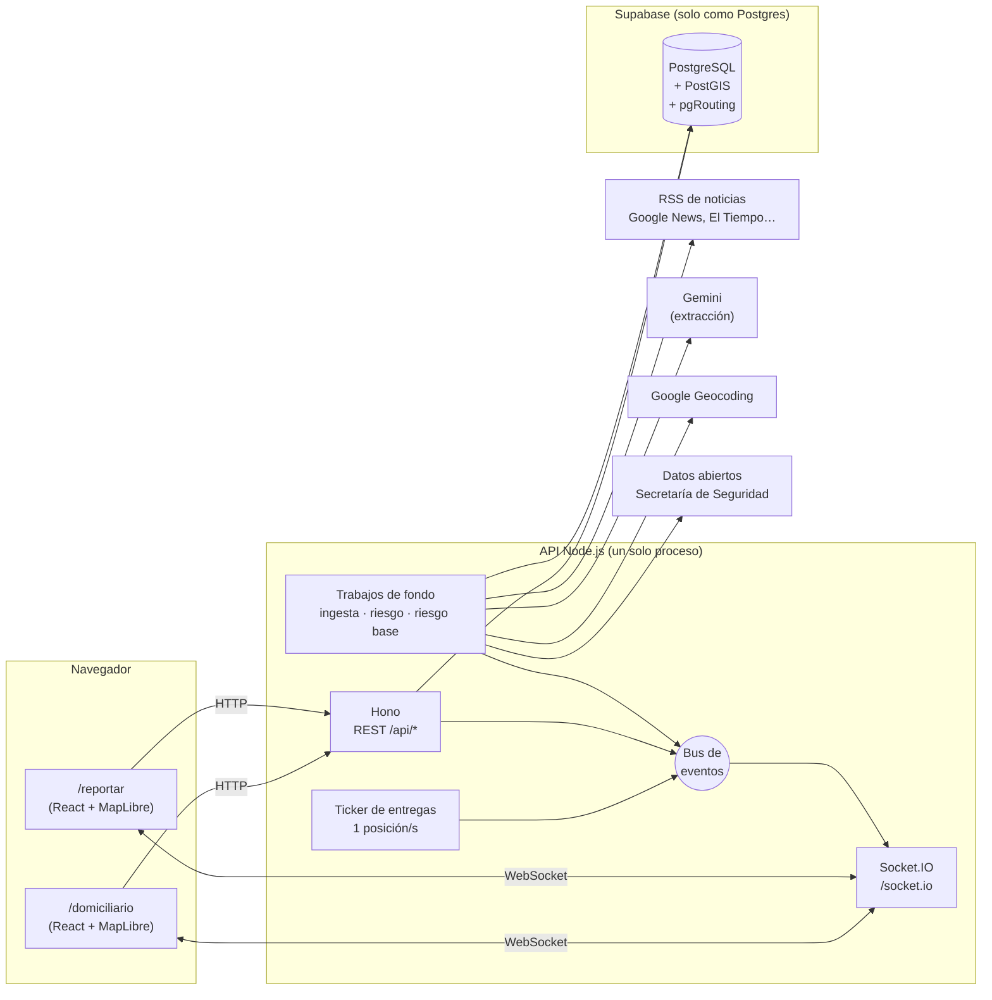
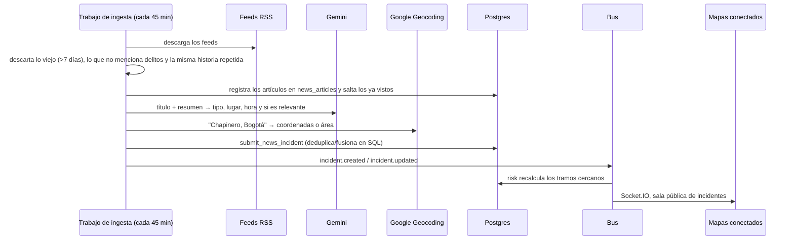
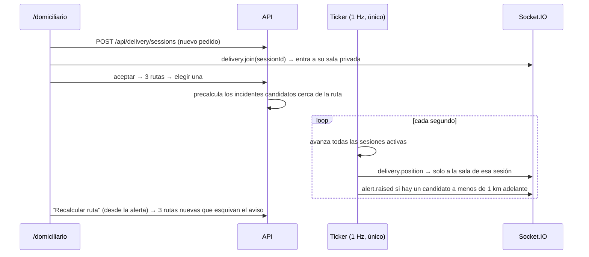

# UrbanSafe

UrbanSafe calcula rutas más seguras para domiciliarios en Bogotá. Combina tres fuentes: noticias de medios, datos abiertos oficiales y reportes de la comunidad. Mientras el domiciliario hace la entrega, la app le avisa de los incidentes que tiene adelante.

Es el MVP de una clase universitaria. Tiene dos vistas web:

- **`/domiciliario`**: simulador de pedidos. Genera un pedido, ofrece 3 rutas (rápida, balanceada y segura), anima el recorrido y lanza alertas en vivo.
- **`/reportar`**: web móvil para reportar incidentes y para confirmarlos o negarlos.

> **Documentos de referencia.** [`docs/spec.md`](docs/spec.md) es la fuente de verdad del producto: módulos M1–M8, reglas RN-xx y parámetros. [`AGENTS.md`](AGENTS.md) recoge las reglas de código, rendimiento y flujo de trabajo. Este README explica cómo encaja todo.

---

## Arquitectura

### Vista general



La arquitectura se apoya en tres ideas:

1. **La base de datos hace el trabajo pesado.** El riesgo por calle, las rutas (Dijkstra con pgRouting) y la deduplicación de incidentes son funciones SQL en PostGIS, definidas en `db/migrations`. Node orquesta y expone el API, pero casi no gasta CPU.
2. **Un solo proceso de Node.** Atiende HTTP y WebSocket, corre los trabajos de fondo y guarda en memoria las sesiones de entrega. Por eso **solo puede haber una instancia** del API: con dos, los sockets de una no verían los eventos de la otra.
3. **Las features se comunican por un bus de eventos**, no llamándose entre sí. Por ejemplo, cuando entra un incidente, `risk` recalcula, `alerts` revisa las rutas activas y Socket.IO lo envía a los mapas.

### Stack

| Pieza | Tecnología |
|---|---|
| Lenguaje | TypeScript en todo el repo, monorepo con pnpm workspaces |
| Base de datos | PostgreSQL + PostGIS + pgRouting en Supabase. No se usan su Auth, su Realtime ni su API REST |
| API | Node.js 22 + [Hono](https://hono.dev); SQL tipado con Kysely, sin ORM |
| Tiempo real | Socket.IO, con salas |
| Web | React + Vite + MapLibre GL JS |
| Validación | zod, con esquemas compartidos entre API y web |
| Noticias | RSS → Gemini (salida estructurada) → Google Geocoding |
| Migraciones | SQL puro con dbmate |
| Pruebas | Vitest; las de integración corren contra PostGIS real |

### Estructura del repo

```
apps/
  api/src/
    app/          # arranque: servidor, registro de rutas, scripts (importaciones, ingesta, cargas)
    features/     # una carpeta por funcionalidad (ver tabla abajo)
    shared/       # config, conexión a la base, límite por IP, bus de eventos, Socket.IO
  web/src/
    app/          # router y providers
    pages/        # DeliveryPage (/domiciliario) y ReportPage (/reportar): solo componen features
    features/     # incidents, routing, delivery, alerts, reports, edge-risk, base-risk, safe-places, nickname
    shared/       # mapa base, cliente HTTP, socket único por pestaña
packages/
  shared/src/     # tipos, esquemas zod, contratos HTTP/socket y PARAMS (todos los parámetros del modelo)
db/
  migrations/     # esquema y funciones SQL (refresh_edge_risk, route_between, submit_*…)
  seeds/          # datos de prueba (ids que empiezan por 00000000-0000-4000-8000-)
deploy/           # scripts para montar y desmontar el servidor en AWS
docs/spec.md      # especificación del producto
```

Cada feature agrupa sus rutas, lógica, consultas y componentes en su propia carpeta, y expone solo su `index.ts`. ESLint (`eslint-plugin-boundaries`) bloquea que una feature importe archivos internos de otra.

### Features del API

| Feature | Qué hace | Módulo del spec |
|---|---|---|
| `incidents` | Modelo único `Incidente`: noticias y reportes terminan en la misma tabla. Lectura por caja visible | RN-01, RN-09, RN-12 |
| `news-ingestion` | Cada 45 min: lee RSS → filtra → Gemini extrae tipo, lugar y hora → geocodifica → deduplica → guarda | M1 |
| `open-data` | Riesgo base por localidad a partir del dataset "Delito de Alto Impacto" | M2 |
| `reports` | Reportes de la comunidad, confirmar/negar, reputación y límite por dispositivo | M3 |
| `risk` | Precalcula el riesgo 0–1 de cada tramo de calle por franja horaria | M4 |
| `routing` | 3 rutas con Dijkstra ponderado por riesgo, con cola de concurrencia y caché | M5 |
| `alerts` | Avisa de incidentes recientes adelante en la ruta activa | M6 |
| `delivery` | Pedidos simulados, posición simulada en el servidor y resumen de la entrega | M7 |
| `safe-places` | CAI, policía y gasolineras 24 h desde OpenStreetMap | M6, M8 |

---

## Cómo fluyen los datos

### 1. De una noticia a un incidente en el mapa (M1)



- La mayoría de las noticias se descarta **antes** de llegar al LLM: por fecha, por no mencionar delitos o por ser duplicadas. Así se ahorran llamadas.
- Una ubicación imprecisa (solo la localidad o el barrio) se guarda como **área** con menos confianza. Una dirección concreta se guarda como **punto**.
- Un advisory lock de Postgres impide que dos corridas de ingesta se solapen.
- Para probarla a mano: `pnpm ingest:news` (corrida completa) o `pnpm ingest:news --dry-run` (solo lee los feeds).

### 2. Modelo de riesgo (M4)

Cada tramo de calle (`road_edges`, tomado de OpenStreetMap) tiene un riesgo precalculado entre 0 y 1:

```
riesgo(tramo, hora) = (0,3 · riesgo_base_localidad + 0,7 · riesgo_reciente) × multiplicador_horario
```

- **Riesgo reciente:** suma los incidentes a menos de 250 m, ponderados por gravedad, confianza y antigüedad. La antigüedad decae exponencialmente con τ = 3 días: un incidente de hace una semana pesa ~10 %.
- **Riesgo base:** delitos/km² de la localidad según los datos oficiales, normalizado a 0–1.
- **Multiplicador horario:** el patrón por localidad y franja de 6 h, acotado a [0,5; 2].

El riesgo se recalcula de forma incremental cuando entra un incidente (solo los tramos cercanos) y completo cada hora, para aplicar el decaimiento. Todo vive en la función SQL `refresh_edge_risk`.

### 3. Ruteo seguro (M5)

`route_between` corre Dijkstra (pgRouting) sobre un **recorte** del grafo: la caja de origen y destino más 2 km. El costo de cada tramo es:

```
costo = tiempo_de_recorrido × (1 + α · riesgo)        α: rápida 0 · balanceada 1 · segura 5
```

- La ruta segura además multiplica ×11 el costo de los tramos cercanos a incidentes graves y recientes. Son las "zonas a evitar" de RN-13.
- Las 3 rutas se calculan **en serie dentro de una sola consulta**: en paralelo se estorban en la CPU de la base.
- Una cola (`p-limit`) permite 4 cálculos a la vez y hasta 30 en espera. Si se llena, el API responde 503. Hay además una caché de 5 minutos que se invalida cuando cambia el riesgo.

### 4. Entrega simulada y alertas (M6, M7)



- **La posición se simula en el servidor** y no en el navegador. Así las alertas funcionarían igual con GPS real.
- **Un único ticker** mueve todas las sesiones. No hay un `setInterval` por usuario.
- **Privacidad (RN-03):** la posición y la ruta de un domiciliario solo van a **su sala** (`delivery:<sesión>`). `/reportar` nunca recibe datos de domiciliarios.
- **El sistema sugiere recalcular, pero nunca cambia la ruta solo** (RN-08).

### 5. Reportes comunitarios (M3)

Un usuario de `/reportar` toca el mapa, elige el tipo y envía. `submit_community_report` aplica el límite por dispositivo y deduplica contra incidentes cercanos, todo en una transacción. Después el incidente sale al bus y aparece en todos los mapas en menos de 1 s.

Los reportes nuevos entran con confianza 0,3. Las confirmaciones la suben (+0,15) y las negaciones la bajan (−0,2). Por debajo de 0,1 el incidente se oculta.

### Eventos del bus y de Socket.IO

| Evento | Quién lo emite | A quién le llega |
|---|---|---|
| `incident.created` / `incident.updated` | ingesta, reportes, votos | `risk` (recalcula), `alerts` y la sala pública de Socket.IO |
| `risk.refreshed` | `risk` | `routing` (invalida la caché) |
| `delivery.updated` / `delivery.position` | `delivery` | solo la sala privada de la sesión |
| `alert.raised` | `alerts` | solo la sala privada de la sesión |

---

## Correr en local

Requiere Node ≥ 22 y pnpm 10.

```bash
pnpm install
cp .env.example .env     # pide a alguien del equipo DATABASE_URL y las claves de Gemini y Geocoding
pnpm dev                 # API en :3000 y web en :5173 (Vite redirige /api y /socket.io al API)
```

Abre http://localhost:5173/domiciliario y http://localhost:5173/reportar. Todos usamos el mismo proyecto de Supabase, así que **no corran `pnpm db:seed` ni las importaciones** sin avisar al equipo.

Antes de subir cambios: `pnpm typecheck && pnpm lint && pnpm test`. Los demás comandos (migraciones, importaciones, pruebas de carga) están en [`AGENTS.md`](AGENTS.md#comandos).

## Despliegue (demo en AWS)

Para la demo, la app corre en **una sola instancia EC2** (`t4g.small`, región São Paulo, la misma de Supabase):

```
Navegador ──HTTPS/WSS──▶ Caddy (:443, certificado automático) ──▶ Node API (:3000) ──▶ Supabase
```

- En producción, el API también sirve la web compilada (`WEB_DIR=apps/web/dist`). Así la web, `/api` y `/socket.io` comparten dominio y no hace falta CORS.
- Caddy saca el certificado HTTPS de Let's Encrypt para un dominio `<ip>.sslip.io`, así que no hace falta comprar uno, y deja pasar WebSocket sin configuración extra.
- `deploy/setup.sh` instala Node, el servicio de systemd, Caddy y un **apagado programado**: la instancia se lanza con `shutdown-behavior=terminate`, así que al apagarse se borra sola.
- `deploy/teardown.sh` borra lo demás: security group, key pair y budget.
- `MAP_WINDOW_DAYS` (opcional) amplía cuántos días de incidentes muestra el mapa (por defecto 7). Sirve, por ejemplo, para una demo después de semanas sin ingesta.

Como el estado de las entregas vive en memoria, **reiniciar el servidor corta las entregas en curso**.
